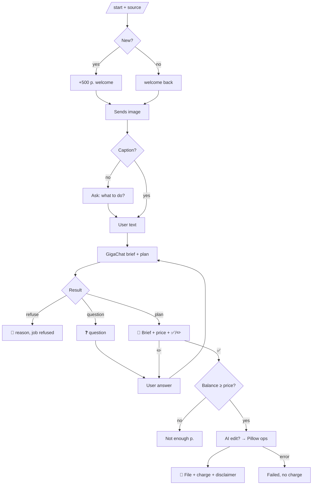

# PRODUCT — imgrsz

Requirements and metrics: `AI/PRD.md`. Texts: `bot/app/texts.py`. Prices: `bot/app/config.py`.

## User flow

Edit loop limit: 5 iterations per image. The brief always shows the final size («Итог: W×H px»), computed in code (`pipeline.output_size`), not by the LLM.

## Pricing
Values live in `bot/app/config.py` (brief free, technical, AI, welcome bonus). The brief shows only the price, no category. Charged only after successful delivery. AI price covers the worst case of a wide extension (up to ~$0.15 of model calls).

## Supported tasks (examples users write)
| Request | Plan |
|---|---|
| «квадрат для госуслуг до 1 МБ» | crop_ratio 1:1 → max_size_kb 1000 |
| «фото 35×45 для визы» | print_size 35×45@300dpi → jpeg |
| «расширь до 16:9 для обложки» | extend 16:9 → resize |
| «баннер 468×60», «5120×1440» | extend 468:60 / 5120:1440 (whole source kept, see TECH) → resize exact |
| «убери фон» | AI background removal (plain white) → jpeg |
| «HEIC в JPG, убери метаданные» | format jpeg |
| «до 200 КБ, ширина 800» | resize fit 800 → max_size_kb 200 |
| «сделай 300×300» (фото 3:4) | resize fill 300×300 — exact size, center crop; brief offers AI extension instead |
| «увеличь до 1080×1920 и дорисуй» (фото 4:3) | extend 9:16 → resize exact; never stretched (TECH → plan guards) |
| «убери фон, сделай 16:9» | AI background removal → pad 16:9 with the background colour |
| «поверни на 90 градусов» | rotate 90 (no orientation question) |
| «сделай в хорошем качестве» | enhance — only when quality is asked for, and as the last AI step |

## Positioning
A resize service, not a photo editor. AI only extends edges, restores detail and removes the background (to plain white); it does not draw new scenes or change people.

## Admin bot (@imgrsz_admin_bot)
Admins from `ADMIN_USERNAMES` get every source + result with request, brief, price and real cost. `/drop @username` (or `/drop` for yourself) forgets a user so the next `/start` is a new user with a fresh bonus — for testing onboarding.

## Bot profile (set in @BotFather)
- **Name:** Поправь размер картинки (landing brand: Image resizer)
- **About (≤120):** Подгоню фото под требования формы: размер, вес, формат, пропорции, без метаданных. Расширю и улучшу с ИИ.
- **Description (≤512):** Картинка не грузится? Пришлите её и напишите своими словами, что нужно: «1080×1080 до 500 КБ», «расширь до 16:9», «фото 35×45 на белом фоне». Я составлю бриф, вы подтвердите — и получите готовый файл. 🎁 500 р. на старте.
- **Commands:** `start - Начать`, `help - Как это работает`, `balance - Баланс`
