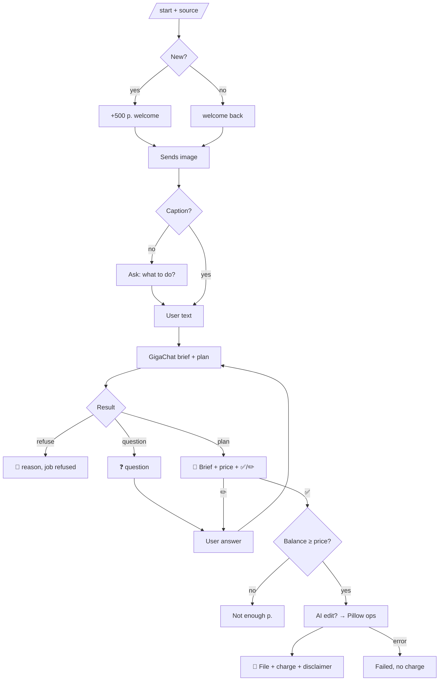

# PRODUCT — imgrsz

Requirements and metrics: `AI/PRD.md`. Texts: `bot/app/texts.py`. Prices: `bot/app/config.py`.

## User flow

Edit loop limit: 5 iterations per image.

## Pricing
Brief 0 р. · technical 5 р. · AI 30 р. · welcome 500 р. Charged only after successful delivery.

## Supported tasks (examples users write)
| Request | Plan |
|---|---|
| «квадрат для госуслуг до 1 МБ» | crop_ratio 1:1 → max_size_kb 1000 |
| «фото 35×45 для визы» | print_size 35×45@300dpi → jpeg |
| «расширь до 16:9 для обложки» | AI outpaint (ai_ratio 16:9) → resize |
| «сделай белый фон» | AI background replace → jpeg |
| «HEIC в JPG, убери метаданные» | format jpeg |
| «до 200 КБ, ширина 800» | resize fit 800 → max_size_kb 200 |

## Bot profile (set in @BotFather)
- **Name:** Поправь размер картинки (landing brand: Image resizer)
- **About (≤120):** Подгоню фото под требования формы: размер, вес, формат, пропорции, без метаданных. Расширю и улучшу с ИИ.
- **Description (≤512):** Картинка не грузится? Пришлите её и напишите своими словами, что нужно: «1080×1080 до 500 КБ», «расширь до 16:9», «фото 35×45 на белом фоне». Я составлю бриф, вы подтвердите — и получите готовый файл. 🎁 500 р. на старте.
- **Commands:** `start - Начать`, `help - Как это работает`, `balance - Баланс`
