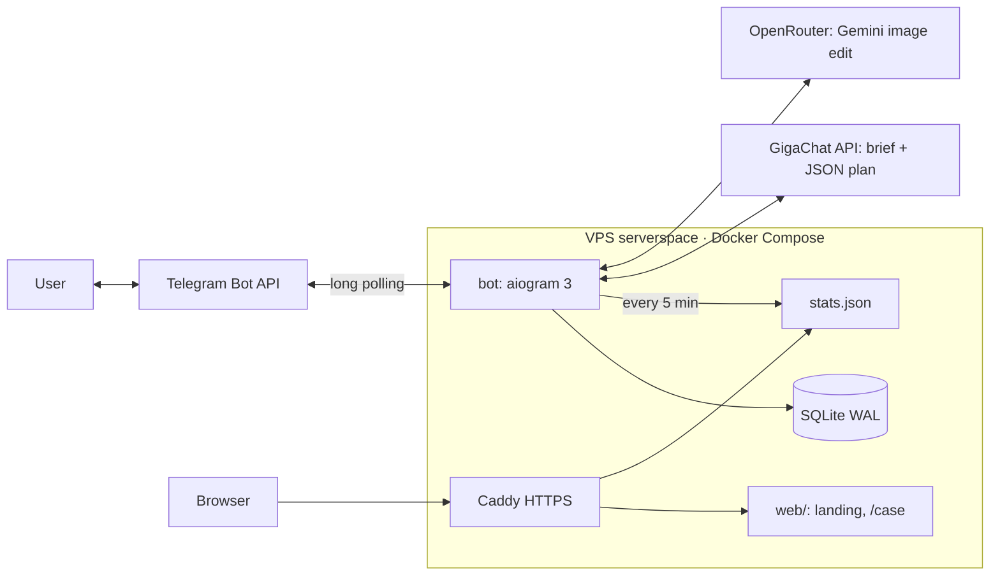

# TECH — imgrsz

## Architecture

Showcase image: `web/assets/architecture.svg`.

## Request flow
1. `handlers.on_image` downloads the file, `pipeline.describe()` extracts facts (size, format, alpha, metadata) and a `jobs` row is created (`status=draft`).
2. `llm.GigaChat.make_plan()` sends the system prompt, the image facts and the user text (wrapped in `<<<>>>`). It expects JSON and retries once on a bad answer.
3. `plan.parse_plan()` validates against the allow-list (op names, types, ranges). **The price is computed in code** (`Plan.price`), never by the LLM.
4. The user confirms → `db.claim_job()` (draft→running, protects against double-taps) → optional `providers.*.edit()` → `pipeline.run()` → `db.charge()` (atomic, only after success) → result sent as a document.

## Modules (`bot/app/`)
| File | Role |
|---|---|
| `config.py` | env and **prices/bonus (single source of truth)** |
| `handlers.py` | aiogram router, FSM states `waiting_task`, `waiting_edit` |
| `llm.py` | GigaChat OAuth (token cached about 30 min), chat, system prompt |
| `plan.py` | Plan schema, validation, price |
| `pipeline.py` | Pillow ops, encode without metadata, binary search on quality for `max_size_kb` |
| `providers.py` | `ImageEditProvider` → `OpenRouterProvider` and `FakeProvider` |
| `db.py` | SQLite schema, ledger, jobs, events |
| `analytics.py` | `stats.json` export (atomic write) |
| `texts.py` | all RU user-facing texts |

## Key decisions
- **GigaChat cannot edit images** (only text2image), so image edits go to OpenRouter (`google/gemini-3.1-flash-lite-image`, about $0.034 per edit, measured). You can switch with `OPENROUTER_MODEL`.
- **Metadata:** outputs are re-encoded by Pillow without passing exif, xmp, icc or pnginfo, so EXIF, GPS, XMP, IPTC and C2PA are all gone. The bot message carries an AI disclaimer instead. An invisible pixel watermark from the model (SynthID), if present, is not metadata and is not affected.
- **TLS:** GigaChat uses the Russian Trusted Root CA, stored in `deploy/certs/` and loaded only for the GigaChat client.
- **Polling, not webhook:** there is no inbound port for the bot, and the setup is simpler for a single instance.
- **SQLite:** a single writer and low volume make it a good fit. Move to Postgres with more than one instance.
- **The stats exporter runs inside the bot process** (an asyncio task), so there is one container fewer on a 1 GB VPS.

## Environment
See `deploy/.env.example`. Secrets live only in `credentials.env` (gitignored).

## Local dev
```
python3 -m venv .venv && .venv/bin/pip install -r bot/requirements-dev.txt
cd bot && ../.venv/bin/pytest                       # unit tests
set -a; . ../credentials.env; set +a; IMAGE_PROVIDER=fake ../.venv/bin/python -m app.main
```
A running local bot competes with production for updates (polling). Use a separate test bot token locally.
