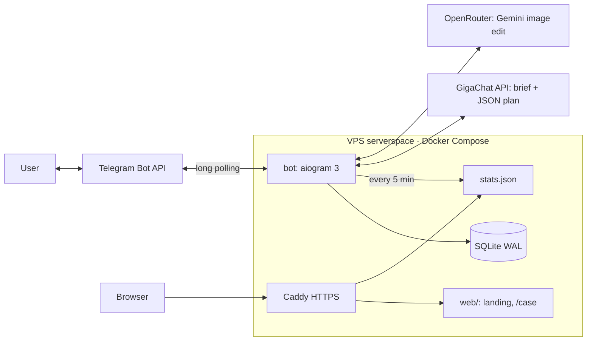

# TECH — imgrsz

## Architecture

Showcase image: `web/assets/architecture.svg`.

## Request flow
1. `handlers.on_image` downloads the file, `pipeline.describe()` extracts facts (size, format, alpha, metadata) and a `jobs` row is created (`status=draft`).
2. `llm.GigaChat.make_plan()` sends the system prompt, the image facts and the user text (wrapped in `<<<>>>`). It expects JSON and retries once on a bad answer.
3. `plan.parse_plan()` validates against the allow-list (op names, types, ranges). **The price is computed in code** (`Plan.price`), never by the LLM.
4. The user confirms → `db.claim_job()` (draft→running, protects against double-taps) → optional `providers.*.edit()` → `pipeline.run()` → `db.charge()` (atomic, only after success) → result sent as a document.

## Modules (`bot/app/`)
| File | Role |
|---|---|
| `config.py` | env and **prices/bonus (single source of truth)** |
| `handlers.py` | aiogram router, FSM states `waiting_task`, `waiting_edit` |
| `llm.py` | GigaChat OAuth (token cached about 30 min), chat, system prompt |
| `plan.py` | Plan schema, validation, price, `nearest_ai_ratio` (AI output ratio = source ratio) |
| `prompts.py` | fixed image-edit invariant + task templates rendered from `ai_op` |
| `pipeline.py` | Pillow ops, encode without metadata, binary search on quality for `max_size_kb` |
| `providers.py` | `ImageEditProvider` → `OpenRouterProvider` and `FakeProvider` |
| `db.py` | SQLite schema, ledger, jobs, events |
| `analytics.py` | `stats.json` export (atomic write) |
| `texts.py` | all RU user-facing texts |
| `admin.py` | admin bot (@imgrsz_admin_bot): one album per job — original, output, and `job<id>_system_prompt.md` (AI op, ratio, request, brief, full rendered prompt, cost) |

## Key decisions
- **GigaChat cannot edit images** (only text2image), so image edits go to OpenRouter (`google/gemini-3.1-flash-lite-image`, about $0.034 per edit, measured). You can switch with `OPENROUTER_MODEL`.
- **AI prompts are assembled, not written by the LLM:** `prompts.py` holds a fixed invariant (the source image is the ground truth) and a task template per `ai_op`; `plan.py` renders the final prompt. The LLM only chooses the op and parameters, so wording cannot drift per image. The AI output ratio is computed from the source (`nearest_ai_ratio`) — the model never changes framing; ratio changes go through `extend.py` or Pillow.
- **Metadata:** outputs are re-encoded by Pillow without passing exif, xmp, icc or pnginfo, so EXIF, GPS, XMP, IPTC and C2PA are all gone. The bot message carries an AI disclaimer instead. An invisible pixel watermark from the model (SynthID), if present, is not metadata and is not affected.
- **TLS:** GigaChat uses the Russian Trusted Root CA, stored in `deploy/certs/` and loaded only for the GigaChat client.
- **Polling, not webhook:** there is no inbound port for the bot, and the setup is simpler for a single instance.
- **SQLite:** a single writer and low volume make it a good fit. Move to Postgres with more than one instance.
- **The stats exporter runs inside the bot process** (an asyncio task), so there is one container fewer on a 1 GB VPS.

## Admin bot
`ADMIN_BOT_TOKEN` and `ADMIN_USERNAMES` (comma-separated, without @; default `felixnamba`). Bots cannot write first, so each admin sends `/start` to @imgrsz_admin_bot once; their `chat_id` is saved in the `admins` table. Others get "Нет доступа". Both bots poll from one process (two dispatchers). A notify failure never affects the user's result.

## Landing images
`scripts/landing_assets.py` produces every landing image with the bot's own pipeline (real outputs, about $0.15 per full run). The hero (limo 1360×1236 → 5120×1440, 900 КБ) is a real run of `bot/app/extend.py`.

## AI extension to any ratio (`bot/app/extend.py`)
Plan field `extend: "W:H"` (any ratio 1:10…10:1). Gemini outputs only fixed ratios (max 21:9 / 9:16) and crops when asked to zoom out, so:
1. The source is pasted at native size on a flat gray canvas of the target ratio.
2. In-range ratios: one call, padded to the nearest supported ratio, then cropped back.
3. Wider/taller: windows of 21:9 (9:16) along the axis, each with 40% overlap on filled pixels, center-out.
4. Only gray pixels (+32 px feather) are taken from the model, so the source is untouched.
5. Lines the model left gray stay unfilled and get another window; max 6 calls, else the job fails (no charge).
Typical cost: 32:9 → 2–3 calls (~$0.07–0.10); 468×60 → ~5 calls.

## Environment
See `deploy/.env.example`. Secrets live only in `credentials.env` (gitignored).

## Local dev
```
python3 -m venv .venv && .venv/bin/pip install -r bot/requirements-dev.txt
cd bot && ../.venv/bin/pytest                       # unit tests
set -a; . ../credentials.env; set +a; IMAGE_PROVIDER=fake ../.venv/bin/python -m app.main
```
A running local bot competes with production for updates (polling). Use a separate test bot token locally.
